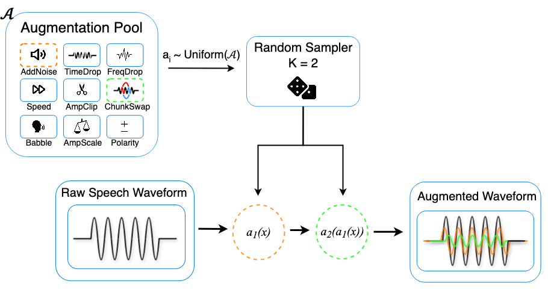

# Wav2Aug: A Drop-In Speech Augmentation Policy

A minimalistic PyTorch-based augmentation library for speech augmentation. The goal of this library is to provide a drop-in speech augmentation policy that can be used on any task and perform reasonably well without having to tune augmentation hyperparameters. Just install, and start augmenting. Applies two random augmentations per call. Just install and start augmenting!

Our experiments show that Wav2Aug performs comparably to SpecAugment on ASR and better on average across the evaluated non-ASR tasks. See our [paper](https://arxiv.org/abs/2610.38656) for details.



## Installation

Requires Python 3.10+ and FFmpeg shared libraries for TorchCodec audio decoding.
Install FFmpeg before running the quick start:

```bash
# macOS (Homebrew)
brew install ffmpeg

# Ubuntu / Debian
sudo apt-get update && sudo apt-get install -y ffmpeg
```

For Windows and other platforms, follow the
[TorchCodec installation instructions](https://github.com/meta-pytorch/torchcodec#installing-torchcodec).
If installing into an existing PyTorch environment, check TorchCodec's compatibility
table for your PyTorch version.

### pip

```bash
pip install wav2aug
```

### uv

```bash
uv add wav2aug
```

## Quick Start

```python
import torch
from wav2aug.gpu import Wav2Aug

# Initialize the augmenter once
augmenter = Wav2Aug(sample_rate=16000)

# in the forward pass
wavs = torch.randn(3, 50000)
lens = torch.ones((wavs.size(0)))

aug_wavs, aug_lens = augmenter(wavs, lens)

# or just

aug_wavs = augmenter(wavs)
```

That's it!

By default, each call samples two augmentations with replacement from the top six
(`top_k=6`) and applies them sequentially. The same operation can be selected twice,
with random parameters sampled independently for each application. Set `top_k=9`
to sample from all nine augmentations, or `top_k=1` to apply noise addition once.

The first initialization downloads a roughly 569 MB noise archive from Hugging Face
and preloads the decoded audio into RAM. Later initializations reuse the downloaded
files. Set `WAV2AUG_DATA_DIR` before importing wav2aug to change the cache location
(default: `~/.cache/wav2aug`), or supply your own audio directory to avoid downloading:

```python
augmenter = Wav2Aug(sample_rate=16000, noise_dir="/path/to/noise")
```

## Augmentation Types

* **Amplitude Scaling/Clipping**: Random gain and peak limiting
* **Noise Addition**: Environmental noise with SNR control
* **Frequency Dropout**: Spectral masking with random notch filters
* **Polarity Inversion**: Random phase flip
* **Chunk Swapping**: Temporal segment reordering
* **Speed Perturbation**: Time-scale modification
* **Time Dropout**: Random silence insertion
* **Babble Noise**: Multi-speaker background (auto-enabled with sufficient buffer)

**Randomness**: all stochastic ops use PyTorch RNGs. Set a single seed and be done, e.g. torch.manual_seed(0); torch.cuda.manual_seed_all(0)


## Development Installation

### uv

```bash
git clone https://github.com/gfdb/wav2aug
cd wav2aug

# create venv and pin Python
uv venv
source .venv/bin/activate
uv python pin 3.10  # or 3.11/3.12

# runtime only
uv sync

# extras
uv sync --extra dev
uv sync --extra test
```

### pip

```bash
git clone https://github.com/gfdb/wav2aug
cd wav2aug

# create venv
python -m venv .venv
source .venv/bin/activate

# runtime only
python -m pip install .

# editable + extras for development
python -m pip install -e '.[dev,test]'
```

## Tests

### uv

```bash
uv run pytest -q tests/
```

### pip

```bash
pytest -q tests/
```

## Contributing

* Feel free to open a PR!

* Bug reports: please open an issue with a minimal repro (env, dep versions, code snippet, expected vs. actual, traceback, etc.)
